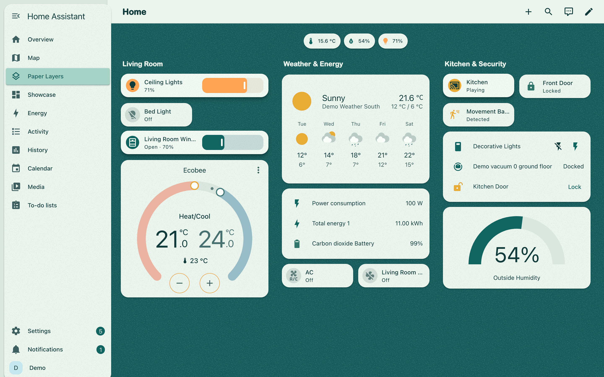
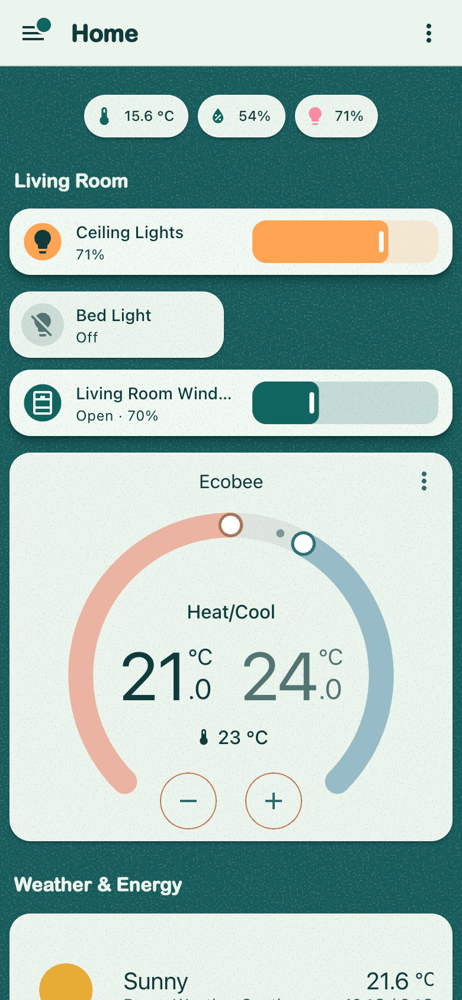
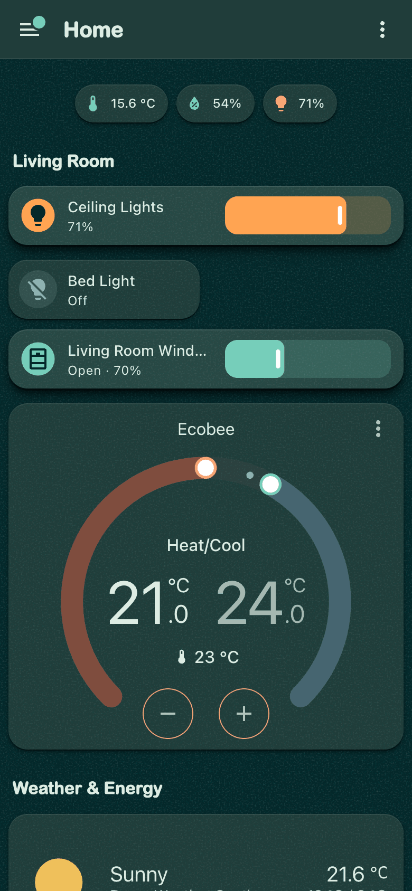
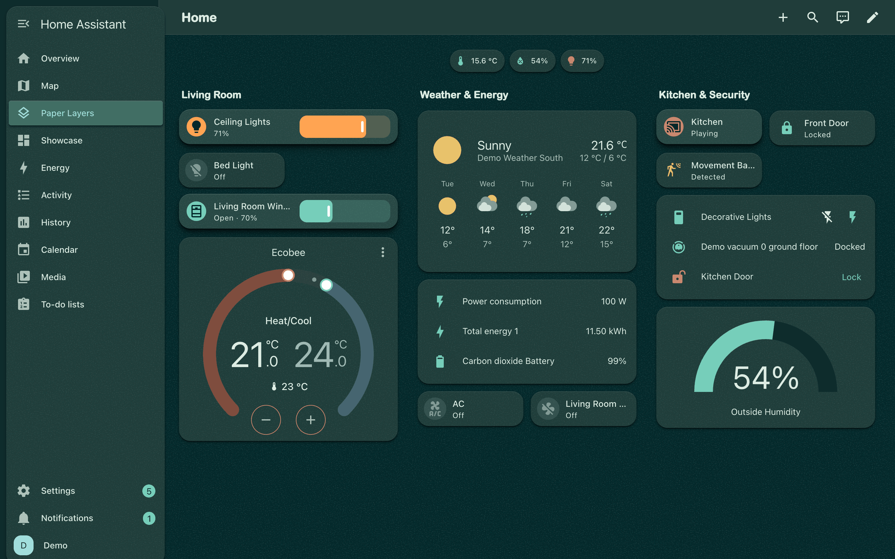
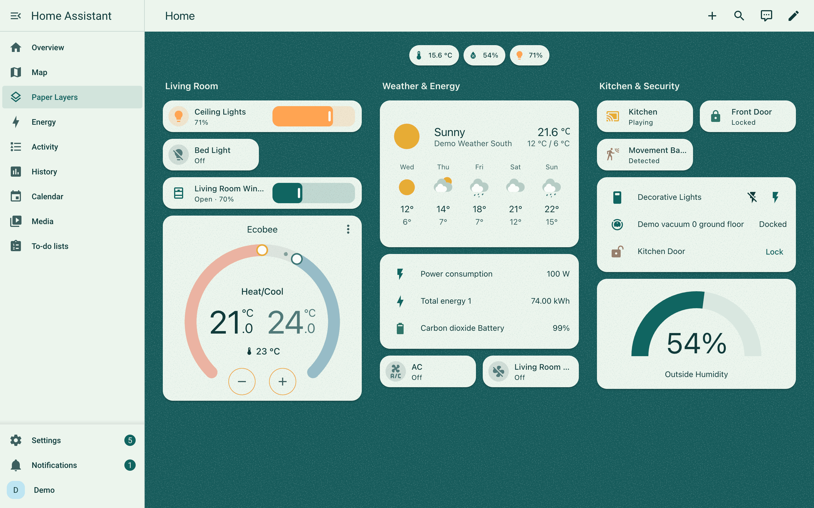
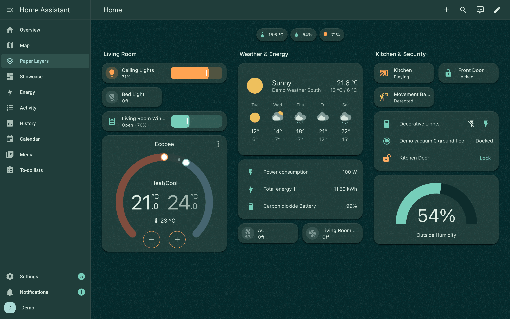
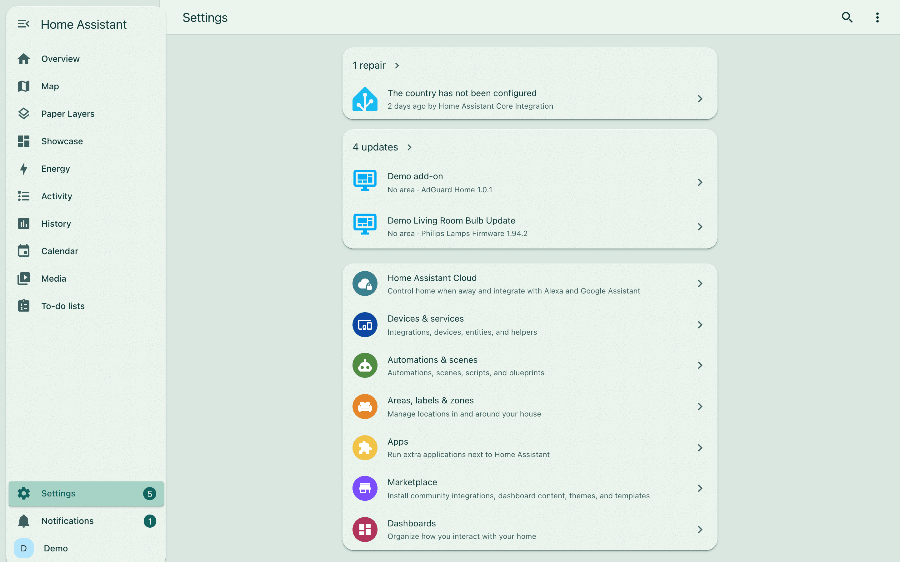
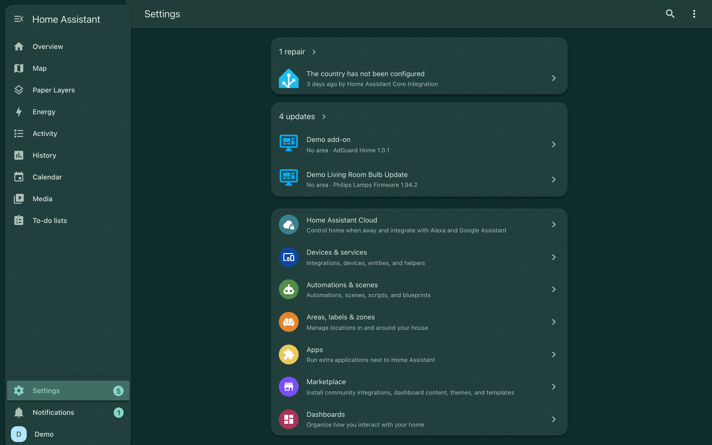
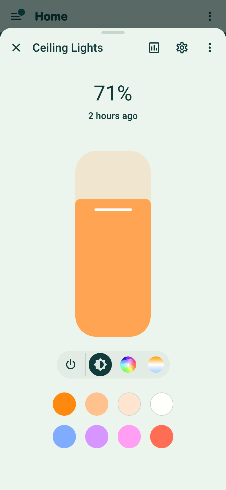
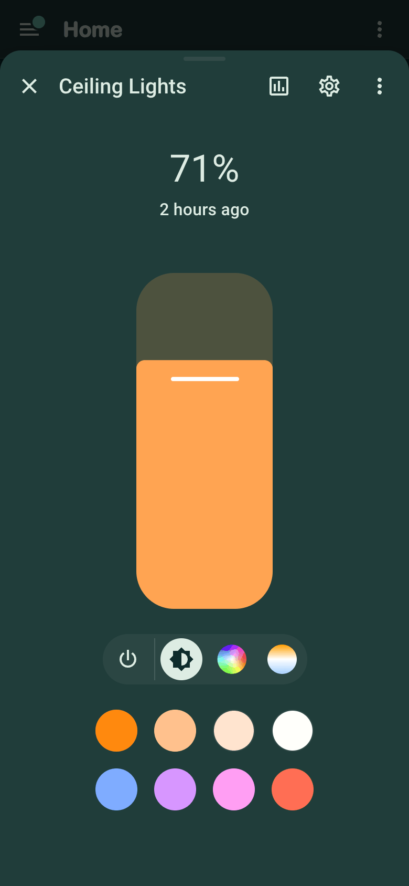

# Paper Layers

[](https://my.home-assistant.io/redirect/marketplace_repository/?owner=wsclx&repository=paper-layers-theme&category=theme)

A cut-paper theme for Home Assistant. Every surface is a sheet of matte card stock, stacked in layers on a deep petrol board: mint-white cards, mustard and coral for warm states, petrol for actions. Depth comes only from short, real shadows between the layers, and switched-on devices sit one layer higher than switched-off ones. Light and dark mode in one theme.



| Light | Dark |
|---|---|
|  |  |



## What you get

- **One theme, two modes.** Light: mint-white sheets on a petrol board. Dark: card stock in deep tones, darker petrol sheets on an almost black-green board, with lighter mint, mustard and coral. It follows the light or dark setting of your profile or device.
- **Layers instead of lines.** Cards have no outline. Each one is a rounded sheet with a short shadow underneath and a faint light edge on top, like card stock cut and glued onto the board.
- **Paper fibre.** Cards and the board carry a very fine fibre structure. It is an SVG embedded in the theme file, so nothing is downloaded, and it is kept faint enough that text stays calm.
- **Warm accents with a job.** Mustard for lights, coral for heating and media, petrol for every other device that is on, for buttons and for selection. In light mode mustard is a surface colour only (paper dots, sliders, the sun); icons and chart lines in that hue use a darker ochre so they keep 3:1 on the mint sheet. Error, warning and success texts use darker variants that keep 4.5:1.
- **Paper switches.** A paper thumb lying on a petrol track, with a short shadow of its own.
- **Rounded system font.** Safari and the Home Assistant apps on Apple devices use the rounded system font for everything. Other browsers use the system UI font; with card-mod, section headings and the dashboard title switch to Arial Rounded where it is installed. Nothing is downloaded.
- **Optional extras with card-mod:** tiles of switched-on devices are lifted one layer higher and their icon becomes a solid paper dot; the sidebar floats as its own sheet with rounded corners and the selected entry raised; section headings and the dashboard title use the rounded heading font.

Without card-mod the theme still works: sheets, colours, shadows, fibre, switches and headings on the board stay the same; tiles of switched-on devices show their state through the icon colour instead of being lifted, and the sidebar is a flat sheet.

| Without card-mod, light | Without card-mod, dark |
|---|---|
|  |  |

| Settings, light | Settings, dark |
|---|---|
|  |  |

| More-info dialog, light | More-info dialog, dark |
|---|---|
|  |  |

## Requirements

- Home Assistant with themes enabled. Tested with Home Assistant 2026.11.2 (November 2026).
- Optional: [card-mod](https://github.com/thomasloven/lovelace-card-mod) 4.x for the lifted tiles and the floating sidebar. Tested with card-mod 4.2.1.

## Installation

### Marketplace (HACS)

1. Open **Settings → Marketplace** (or HACS on older versions).
2. Search for **Paper Layers** and download it.
3. Reload themes: **Developer tools → Actions → `frontend.reload_themes`**.

### Manual

1. Copy `themes/paper_layers.yaml` into the `themes` folder of your configuration.
2. Make sure your `configuration.yaml` loads that folder:

   ```yaml
   frontend:
     themes: !include_dir_merge_named themes
   ```

3. Restart Home Assistant or run `frontend.reload_themes`.

## Use the theme

Open your **profile**, choose **Paper Layers** under *Theme*, and pick *Auto*, *Light* or *Dark*.

## Optional: card-mod

The theme contains `card-mod-card`, `card-mod-root` and `card-mod-sidebar` rules. They only apply when card-mod is installed. For theme rules, card-mod recommends loading it as a frontend module instead of a dashboard resource:

```yaml
frontend:
  themes: !include_dir_merge_named themes
  extra_module_url:
    - /local/community/lovelace-card-mod/card-mod.js
```

Adjust the path to where card-mod is installed on your system.

The layers show best with **tile cards** in a sections dashboard: switched-on lights, switches, fans, covers, climate and media players rise one layer above the rest.

## Customise

Change the variables below in a copy of the theme, or override them with card-mod.

| Variable | Used for |
|---|---|
| `paper-layers-board` | The petrol board behind dashboards |
| `paper-layers-under` | The lower sheet behind settings pages |
| `paper-layers-sheet`, `paper-layers-sheet-up` | Cards, dialogs, toolbar and sidebar; lifted tiles (card-mod) |
| `paper-layers-mint` | Selected sidebar entry (card-mod) |
| `paper-layers-mustard`, `paper-layers-ochre`, `paper-layers-coral` | Lights as a surface (dots, sliders) and as icon or line colour; heating and media |
| `paper-layers-fibre`, `paper-layers-fibre-board` | Fibre structure on sheets and on the board; set to `none` for plain paper |
| `paper-layers-shadow`, `paper-layers-shadow-up` | Shadow of a sheet at rest and lifted |
| `paper-layers-numbers` | Font stack for headings |

## Known limits

- Home Assistant does not guarantee theme variables between releases. If something looks off after an update, please open an issue with your version.
- Without card-mod a theme cannot tell a switched-on tile from a switched-off one, so lifting active tiles one layer higher needs card-mod. Without it, state shows through the icon colour.
- Section headings are drawn directly on the board, so they use the light sheet colour in light mode. A heading card placed inside another card would need its colour changed back.
- Icons stay Material Design Icons; a theme cannot swap them for paper cut-outs. Weather icons, the thermostat ring and the size of switches are drawn by the frontend; the theme only sets their colours.
- Light and media colours that a card takes from the device (a light's RGB colour, album art) stay as they are.
- The rounded font depends on your device: Safari and the Apple apps have it built in; Chrome, Edge and Firefox use the system UI font, and Arial Rounded (where installed) for section headings and the dashboard title with card-mod. If Nunito or Varela Round is installed on the device, the theme uses it.
- Without card-mod the sidebar keeps the default font of the frontend.
- The area behind the floating sidebar belongs to the app, not to the dashboard, so it shows the lower mint sheet, not the petrol board.
- The toolbar is a flat sheet across the top; a theme cannot turn it into a floating card with the badges inside.
- Rows of entities cards have no round icon backgrounds; only tiles get the paper dot (card-mod).
- The card-mod rules target internal elements of the frontend. A frontend update can break them; the theme itself keeps working.

## Contributing

Issues and pull requests are welcome. Please include your Home Assistant version, card-mod version (if used), browser and a screenshot.

## License

[MIT](LICENSE)

This is a community project. It is not affiliated with or endorsed by Home Assistant or the Open Home Foundation.
